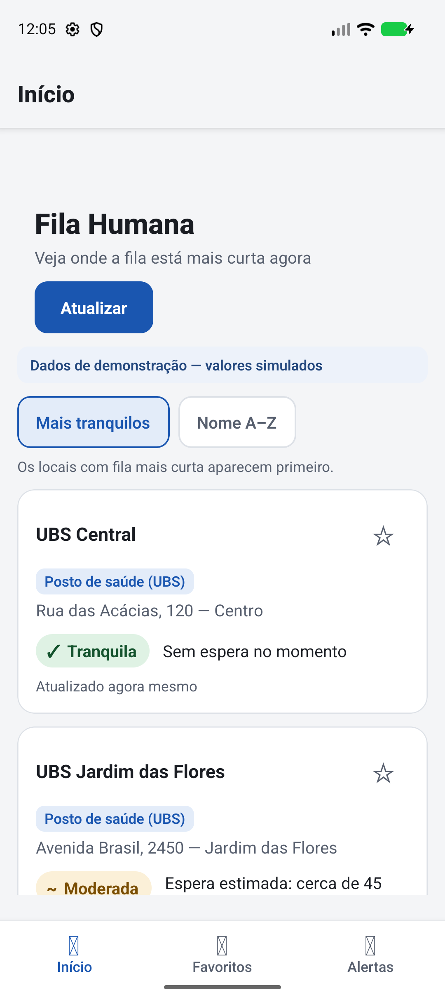

# Fila Humana

Aplicativo mobile em React Native (Expo) que ajuda cidadãos — especialmente idosos e pessoas com pouco tempo — a decidir **onde e quando ir** a locais de atendimento (UBS, Poupatempo), mostrando a situação atual da fila, a estimativa de espera, o histórico por horário e avisos quando a fila ficar tranquila.

## Integrantes

- Denise Senise — RM 556006
- Larissa Rodrigues Lapa — RM 554517
- Mateus Leme — RM 557803
- David Gabriel Gomes Fernandes — RM 556020
- Vinicius Augusto Neves Prestes — RM 559097

## Ficha CitizenTech

**Nome da CitizenTech:** Fila Humana

**Cidade e bairro:** São Paulo — SP (capital) · bairro: [preencher: local observado pelo grupo]

**Cidadão beneficiado:** pessoas idosas e trabalhadores com pouco tempo livre que precisam ir a locais de atendimento público (UBS e Poupatempo) e não sabem quanto vão esperar.

**Problema, em uma frase:** o cidadão perde horas em filas de UBS/Poupatempo sem saber quanto tempo vai esperar nem qual é o melhor horário para ir — e quem tem menos tempo e mobilidade é o mais penalizado.

**Como funciona:** um sensor de contagem em cada local (ESP32) envia a ocupação da fila para uma API (C#/.NET), que guarda as leituras e calcula médias por horário; um modelo de ML responde "qual o melhor horário para ir"; o app mobile mostra ao cidadão a lista de locais com a fila atual, a estimativa de espera e o melhor horário, com favoritos e o aviso "me avise quando estiver tranquilo". Tudo é hospedado e monitorado em servidor Linux, com proteção de dados e testes documentados.

**O que cada parte faz:**

| Parte | O que faz |
|---|---|
| Physical Computing (ESP32 + Wokwi) | Conta pessoas na fila com sensor PIR/ultrassônico, mostra a lotação em LED/display e envia a contagem por Wi-Fi para a API |
| C# Software Development + SOA | API em .NET (mesma base nas duas disciplinas): entidades Local/Leitura de Fila/Usuário, EF Core + LINQ (média de lotação por horário), async/await, Swagger, testes unitários e automatizados |
| Inteligência Artificial & ML | Responde "qual o melhor horário para ir ao serviço X" (Random Forest/XGBoost) com dados reais e públicos (SP156, Bdpoupafila, INMET, IBGE) |
| Mobile (este repositório) | App Expo/React Native: jornada do cidadão — lista de locais, fila atual, melhor horário, favoritos, alertas, banco local SQLite, acessibilidade |
| Operating Systems (Linux) | Provisiona a VM, sobe a API/app e monitora CPU/disco/memória com alertas (serviço systemd tolerante a falhas) |
| Cybersecurity | Mapeia PII (CPF, dados de saúde), impede vazamento em logs/respostas (taint analysis) e gera o indicador "Risco Cidadão" |
| Testing, Compliance & QA (Azure Boards) | Features com critérios de aceite e test cases positivos/negativos (ex.: sensor sem leitura, local inexistente, horário sem dados) |

**Link do repositório:** https://github.com/dav0fc/FilaHumana (aplicativo mobile)

**Indicador de impacto:**

- Tempo médio de espera na fila por visita (minutos), comparando quem usa o app (vai no horário sugerido) contra a média atual do local.
- Proporção de visitas que ocorrem no horário recomendado (deslocamento de demanda do pico para o vale).
- Taxa de uso do aviso: percentual de usuários que criou alerta e foi informado antes de sair de casa.

**ODS conectados:**

| ODS | Como a Fila Humana contribui |
|---|---|
| **ODS 3 — Saúde e bem-estar** | Acesso mais simples e rápido aos serviços de saúde (UBS): reduzir horas perdidas em fila aumenta a procura por atendimento preventivo e o uso adequado dos serviços. |
| **ODS 10 — Redução das desigualdades** | Igualdade de acesso a serviços públicos: quem tem menos tempo, mobilidade ou informação deixa de ser penalizado; a acessibilidade do app (fonte grande, alto contraste, linguagem simples) inclui idosos e pessoas com baixa letragem digital. |
| **ODS 11 — Cidades e comunidades sustentáveis** | Serviços públicos urbanos mais eficientes e centrados no cidadão: dados de fluxo ajudam a planejar horários, reduzir aglomeração e deslocamentos desnecessários. |

## Problema e público-alvo

Fila presencial significa tempo perdido: chegar cedo, esperar desconhecido, voltar depois. O app responde, em linguagem simples, às três perguntas que importam para quem vai a um atendimento:

1. **Onde** a fila está mais curta agora?
2. **Quanto tempo** devo esperar?
3. **Quando** costuma ser o melhor horário para ir?

O público-alvo não é especialista em tecnologia: por isso a interface usa poucos elementos por tela, textos grandes, estados sempre em palavra ("Tranquila", "Moderada", "Cheia") e ações grandes de tocar.

## Jornada principal do cidadão

1. Abrir o app e ver a lista de locais de atendimento com a situação da fila de cada um (os mais tranquilos podem vir primeiro, com um toque no seletor de ordenação).
2. Ver o "Atualizado há X min" de cada local para saber se a informação é fresca.
3. Tocar no card do local para **expandir os detalhes no lugar**: descrição, espera média por horário (barras) e o **melhor horário** sugerido.
4. Guardar o local nos **favoritos** (estrela) para consultar com facilidade.
5. Criar um **alerta** tocando no **sino** do card (estado visível, estilo YouTube: mudo e esmaecido desligado, cheio e destacado quando ativo). Quando o app recebe uma atualização em que a fila está tranquila, chega uma notificação no aparelho e o alerta é concluído.
6. Ver e **cancelar** alertas na aba Alertas.

## Funcionalidades implementadas

- Lista de locais com situação da fila, estimativa de espera e horário da última atualização
- Ordenação "Mais tranquilos" / "Nome A–Z" (preferência persistida no banco)
- Card expandível no lugar: descrição, histórico por horário (barras) e melhor horário sugerido, sem trocar de tela
- Sino de alerta em cada card, com estado visível (ativo/desligado)
- Favoritos com persistência (fechar e reabrir o app mantém)
- Alertas "avisar quando estiver tranquila": criar, listar, cancelar, persistência, disparo por notificação local
- Botão "Atualizar" que força nova leitura dos dados
- Estados de tela em todo lugar: carregando, erro com "tentar novamente", vazio com explicação
- Dados identificados como **simulados** na interface (faixa "Dados de demonstração" em todas as listas)

## Tecnologias

| Tecnologia | Versão | Uso |
|---|---|---|
| React Native | 0.88.1 | framework |
| **Expo** | SDK 58 | plataforma (rota no Expo Go ou dev build) |
| React | 19.3.0 | UI |
| TypeScript | 6.0 | tipagem forte, sem `any` |
| Expo Router | 58 | navegação (abas Início/Favoritos/Alertas + pilha de detalhe) |
| **expo-sqlite** | 58 | banco de dados local (favoritos, alertas, preferências) |
| **expo-notifications** | 58 | notificações locais dos alertas |

Sem backend, sem Firebase, sem login: a jornada do cidadão não exige identificação e o escopo do trabalho é o app mobile.

## Mock: o que é simulado e onde trocar pela API real

A demonstração roda **100% com mock** (`src/services/mock-queue.ts`):

- 6 locais (UBS e Poupatempo), cada um com contador de pessoas, nível de fila ("Tranquila" / "Moderada" / "Cheia" / "Sem informação") e estimativa de espera.
- A simulação muda a fila **a cada 30 segundos** (passo aleatório determinístico, com semente fixa) e avisa as telas — é por essa atualização que o botão "Atualizar" e os alertas funcionam na demo.
- Casos de estado incluídos de propósito: **UBS Santa Rita** está com o sensor desligado (nível "Sem informação", sem contagem e sem histórico) e o **Poupatempo Centro** tem contagem mas **sem estimativa de espera**.
- O histórico por horário (7h–19h) é gerado uma vez, determinístico, e alimenta o "melhor horário para ir".
- A faixa **"Dados de demonstração — valores simulados"** aparece nas telas de lista para que nenhum número seja lido como medição real.

**Onde trocar pela API real:** as telas falam só com a interface `QueueRepository` (`src/services/queue-repository.ts`). Quando a API da equipe de IoT/controle existir, basta criar um `api-queue.ts` implementando a mesma interface (URL-base centralizada, timeout, validação da resposta) e trocar uma linha em `getQueueRepository()`. Nenhum contrato de API foi inventado: o repositório atual expõe exatamente `getLocations`, `getLocationById`, `getAllStatuses`, `getQueueStatus`, `getHourlyHistory`, `refresh` e `subscribe`.

## Estrutura do projeto

```
├── app.json                    # config Expo (router, sqlite, notifications)
├── src/
│   ├── app/                    # rotas do Expo Router
│   │   ├── _layout.tsx         # pilha + motor de alertas + tema
│   │   ├── (tabs)/
│   │   │   ├── _layout.tsx     # abas Início / Favoritos / Alertas
│   │   │   ├── index.tsx       # lista de locais + ordenação + Atualizar
│   │   │   ├── favoritos.tsx   # locais favoritos
│   │   │   └── alertas.tsx     # alertas ativos + cancelamento
│   ├── components/             # LocationCard (expande no lugar), LocationDetails,
│   │                           # QueueStatusBadge, HourlyBars, DemoBanner,
│   │                           # estados (loading/erro/vazio/botão)
│   ├── database/               # acesso ao SQLite (camada própria, tipada)
│   │   ├── database.ts         # abre o banco e cria o schema
│   │   ├── favorites.ts
│   │   ├── alerts.ts
│   │   └── preferences.ts
│   ├── hooks/                  # use-queue (locais + situação ao vivo)
│   ├── store/                  # stores compartilhadas (useSyncExternalStore):
│   │                           # favorites-store, alerts-store — favoritar ou criar
│   │                           # alerta em qualquer tela atualiza todas na hora
│   ├── services/
│   │   ├── queue-repository.ts # interface QueueRepository + ponto de troca
│   │   ├── mock-queue.ts       # mock determinístico (locais, simulação, histórico)
│   │   ├── alert-engine.ts     # confere alertas a cada atualização
│   │   └── notification-service.ts # permissão + notificação local
│   ├── types/                  # location, queue, alert
│   └── utils/                  # theme (cores/tamanhos), queue-level (rótulos/cores),
│                               # queue-compare (ordenação, melhor horário)
└── docs/screenshots/           # prints reais das telas
```

## Banco de dados local (SQLite)

Tecnologia: **expo-sqlite** (banco real no aparelho, persiste entre execuções do app). O acesso fica isolado em `src/database/`; telas e hooks nunca escrevem SQL.

| Tabela | Colunas | O que persiste |
|---|---|---|
| `favorites` | `location_id` (PK) | locais favoritados (sem duplicata, PK impede) |
| `alerts` | `id` (PK), `location_id`, `condition`, `created_at` | alertas ativos (um por local; recriar substitui) |
| `preferences` | `key` (PK), `value` | preferência de ordenação da lista |

O schema é criado com `CREATE TABLE IF NOT EXISTS` na primeira abertura do banco, o que deixa a inicialização segura em instalação limpa.

**Como verificar a persistência:** favoritar um local, matar o app (X / fechar) e reabrir — a estrela continua marcada. Idem para alertas.

## Alertas: como funcionam e o limite deles

1. No card do local, o toque no **sino** grava o alerta no SQLite e o sino muda para o estado ativo (cheio e destacado).
2. O **motor de alertas** (iniciado no layout raiz) confere os alertas gravados a cada atualização de fila — no mock, a cada 30 s e ao abrir o app.
3. Quando a fila do local atinge o estado configurado, o app dispara uma **notificação local** no próprio aparelho (expo-notifications) e remove o alerta (ele dispara uma vez).
4. Na aba Alertas dá para ver os alertas ativos, quando foram criados e **cancelá-los**.

**Limitação (importante e honesta):** não há servidor por trás desta demonstração. A conferência de condição só acontece com o app aberto — se a fila ficar tranquila enquanto o app está fechado, o aviso não chega. A tela de Alertas e o botão de alerta deixam isso explícito para o usuário. Com a API real em tempo real, o mesmo motor passa a ser alimentado pela assinatura da API, sem mudar telas.

## Acessibilidade

Decisões implementadas (acessibilidade é um dos critérios da avaliação, não acabamento):

- **Nunca só cor**: cada estado de fila tem glifo **e** texto ("✓ Tranquila", "~ Moderada", "✕ Cheia", "? Sem informação"); as cores de fundo reforçam.
- **Áreas de toque grandes** (mínimo 48 dp) em todo controle: cards, estrela de favorito, botões de alerta, seletor de ordenação.
- **Fontes confortáveis** (13–26 dp) que acompanham o ajuste de fonte do sistema: o React Native escala o texto automaticamente e os layouts foram feitos para aguentar — quebra de linha nos blocos de status e ordenação, botões com tamanho **mínimo** (48 dp) que crescem com a fonte, nada de altura fixa que corte o texto.
- **`accessibilityLabel`/`accessibilityHint`/`accessibilityRole`** em todos os controles: o leitor de tela anuncia "UBS Central, Posto de saúde, fila Tranquila, toque para ver detalhes" e não "card".
- **Linguagem de cidadão**, sem termos técnicos: "Espera estimada: cerca de 15 min", "Atualizado há 2 min", "Sem estimativa de espera" — nunca "latência", "telemetria" ou número cru.
- **Feedback claro** após ações: a estrela muda de ☆ para ★, o botão de alerta vira "✓ Aviso criado — cancelar aviso", a lista de alertas/favoritos atualiza na hora.
- **Diferença explícita entre o que se mede e o que se sabe**: "0 pessoas" nunca aparece para dado desconhecido; desconhecido vira o estado "Sem informação".
- App em **modo claro** fixo: paleta única com contraste alto (texto `#1A1D23` sobre `#F4F5F7`), evita o custo de manter dois temas e garante o contraste na demo.

## Instalação e execução

Pré-requisitos: Node 20+ (ou 22+) e, para rodar no celular, o **Expo Go** (Android) ou a dev build (`npx expo run:ios`).

```bash
npm install
npx expo start
```

- **Android/Expo Go:** escaneie o QR code ou toque no link. Notificações locais funcionam no Expo Go.
- **iOS:** `npx expo run:ios` (dev build) ou Expo Go.

Verificações:

```bash
npx tsc --noEmit   # typecheck (strict, sem any)
npx expo lint      # eslint
```

## Testes e verificações executadas

- `npx tsc --noEmit` → sem erros.
- `npx expo lint` → sem erros nem warnings.
- Jornada testada no **emulador Android (Expo Go 58)**: lista com estados Tranquila/Moderada/Cheia/Sem informação, detalhe com histórico e melhor horário, favoritar, criar/cancelar alerta, ordenação e "Atualizar". *(Completar aqui os itens validados no aparelho físico, se houver.)*
- Persistência: favoritar e criar alerta → matar o app → reabrir → dados mantidos (SQLite). *(Confirmar no aparelho ao tirar os prints.)*

## Limitações conhecidas e integrações pendentes

- **Dados 100% simulados**: o mock é determinístico e identificado na interface; a troca para a API real é o ponto único em `getQueueRepository()`.
- **Alertas só com o app aberto**: sem backend não há verificação em segundo plano (documentado na tela e aqui).
- **Sem histórico real de dias**: o "melhor horário" usa média simulada por hora, claramente rotulada como simulada.
- **Sem autenticação/administração**: de propósito — a jornada do cidadão não pede login e funções de gestão de sensores/locais ficam fora do escopo mobile.
- **Sem modo escuro** (decisão de contraste, ver Acessibilidade).

## Telas

| Tela | O que tem |
|---|---|
| Início | lista de locais com situação da fila, estimativa, "atualizado há X", ordenação, "Atualizar", estrela de favorito e sino de alerta em cada card |
| Card expandido | toque no card abre no lugar: descrição, histórico por horário (barras) e melhor horário sugerido — sem trocar de tela |
| Favoritos | locais guardados (mesmos cards expandíveis), vazio com ação |
| Alertas | alertas ativos com local e condição, cancelamento, explicação do limite do aviso |

### Prints

*(Salvar os prints em `docs/screenshots/` com os nomes abaixo.)*

| **Início — lista de locais** | **Início — estados da fila** |
|:---:|:---:|
|  |  |

| **Detalhe do local** | **Favoritos** |
|:---:|:---:|
|  |  |

| **Alertas** | **Notificação do alerta (evidência)** |
|:---:|:---:|
|  |  |
